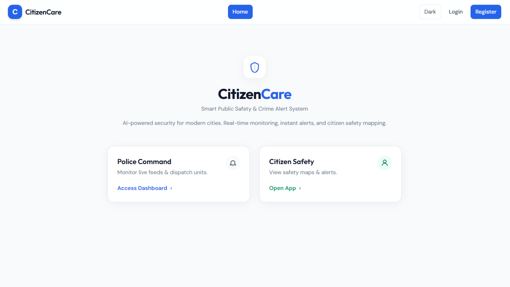

# CitizenCare
<<<<<<< HEAD

**Smart public safety & crime alert system.** Citizens report incidents with evidence and a precise map location; officers verify and respond from a live command centre; a YOLOv8 service watches connected cameras and raises weapon alerts in real time. Administrators manage users, police stations and registration codes from a dedicated portal.

<p align="center">
  
</p>

---

## Contents

- [Architecture](#architecture)
- [Three portals, three roles](#three-portals-three-roles)
- [Quick start](#quick-start)
- [Google Maps setup](#google-maps-setup)
- [Police registration codes](#police-registration-codes)
- [Configuration](#configuration)
- [Project layout](#project-layout)
- [Security model](#security-model)
- [Deployment](#deployment)
- [Troubleshooting](#troubleshooting)
- [Documentation](#documentation)

---

## Architecture

```
┌──────────────┐    REST + Socket.IO    ┌──────────────┐    multipart     ┌──────────────┐
│   React SPA  │◄──────────────────────►│  Express API │◄────────────────►│ Flask+YOLOv8 │
│  (Vite, TW)  │                        │              │   1 frame/sec    │  (ai-model)  │
└──────┬───────┘                        └──────┬───────┘                  └──────────────┘
       │                                       │
       │ Maps JavaScript API                   │ Mongoose
       ▼                                       ▼
┌──────────────┐                        ┌──────────────┐
│ Google Maps  │                        │   MongoDB    │
└──────────────┘                        └──────────────┘
```

| Layer | Stack |
|---|---|
| Frontend | React 18, Vite 5, React Router 6, Tailwind CSS, Recharts, `@react-google-maps/api` |
| Backend | Node 18+, Express 4, Mongoose 8, Socket.IO 4, JWT, bcrypt, Helmet, rate limiting |
| AI | Python 3.10+, Flask, Ultralytics YOLOv8, Pillow, NumPy |
| Storage | MongoDB; media on local disk or Cloudinary |

---

## Three portals, three roles

| Role | How you get it | Where you land | What you can do |
|---|---|---|---|
| **Citizen** | Open self-service signup | `/app` | Report incidents with photos/video and a map pin, check any location's safety score, send an SOS, track your reports |
| **Police** | Signup gated by a **station registration code** | `/police` | Verify or reject reports, respond to SOS alerts, watch live camera feeds and weapon detections, view analytics |
| **Admin** | Created by the seed script, or promoted by another admin | `/admin` | Manage all users and roles, create police stations and rotate their codes, moderate reports, broadcast notices, read the audit log |

Anyone — signed in or not — can browse the public incident map at `/map`, where reports appear **anonymised** and only after an officer has verified them.

---

## Quick start

**Prerequisites:** Node.js 18 or newer, MongoDB (local or Atlas), and — for live CCTV — Python 3.10+.

```bash
git clone <your-repo-url> citizen-care
cd citizen-care

# 1. Install both workspaces
npm run install:all

# 2. Configure
cp server/.env.example server/.env     # set MONGODB_URI and JWT_SECRET
cp client/.env.example client/.env     # optionally set VITE_GOOGLE_MAPS_API_KEY

# 3. Create the first accounts and police station
npm run seed

# 4. Run the API and the web app together
npm run dev
```

| Service | URL |
|---|---|
| Web app | http://localhost:5173 |
| API | http://localhost:5000 |
| API health | http://localhost:5000/api/health |

Generate a real JWT secret rather than using the placeholder:

```bash
node -e "console.log(require('crypto').randomBytes(48).toString('hex'))"
```

### Seeded accounts

`npm run seed` prints these and is safe to re-run. **Change them before deploying.**

| Role | Email | Password |
|---|---|---|
| Admin | `admin@citizencare.local` | `Admin12345!` |
| Police | `police@citizencare.local` | `Police12345!` |
| Citizen | `citizen@citizencare.local` | `Citizen12345!` |

It also creates **Central Police Station** with the code `PS-CENTRAL01`, so you can immediately test police signup.

### Optional: the AI service

Live CCTV weapon detection needs the Python service. Without it, cameras still stream to the dashboard — frames simply are not analysed, and the UI says so.

```bash
cd ai-model
python -m venv .venv

# Windows PowerShell
.\.venv\Scripts\Activate.ps1
# macOS / Linux
# source .venv/bin/activate

pip install -r requirements.txt
python app.py                 # http://127.0.0.1:5050
```

The first run downloads `yolov8n.pt` automatically. See [`ai-model/README.md`](ai-model/README.md) for training a custom weapon model.

---

## Google Maps setup

Maps power the location picker, address search, the incident map and the citizen safety view. Without a key the app still works — pickers fall back to coordinate inputs and maps to tables — but the experience is much better with one.

1. In the [Google Cloud Console](https://console.cloud.google.com/), create a project and **enable billing** (Maps has a generous free tier, but billing must be on).
2. Enable both APIs:
   - **Maps JavaScript API** — renders the maps
   - **Places API** — powers the "Search a place or address…" box
3. Create an **API key** under *APIs & Services → Credentials*.
4. Restrict it: *Application restrictions → HTTP referrers*, allowing `http://localhost:5173/*` for development and your production domain for release.
5. Put it in `client/.env`:

   ```env
   VITE_GOOGLE_MAPS_API_KEY=AIza...
   ```

6. **Restart `npm run dev`** — Vite only reads `.env` at startup.

All map components load the script through one shared loader (`client/src/maps/useGoogleMaps.js`) with identical options, which is what prevents the "Loader must not be called again with different options" error when moving between map pages.

If a map fails to load, the app shows Google's actual error (`RefererNotAllowedMapError`, `BillingNotEnabledMapError`, `ApiNotActivatedMapError`, …) rather than a blank box.

---

## Police registration codes

Police accounts are **not** self-service. Signup at `/register` has two tabs:

- **Citizen** — open to everyone.
- **Police** — requires the registration code of an active station.

`POST /api/auth/register` ignores any `role` in the request body, so the only routes to elevated access are a valid station code or promotion by an existing admin.

**Issuing a code**

1. Sign in as an admin and open **Admin portal → Police stations**.
2. **Add station** — a secure code such as `PS-9GMPAYYS` is generated (or set your own).
3. **Reveal** and **Copy** it, then share it with your officers privately.
4. If it leaks, **Rotate** it — anyone holding the old code is locked out immediately, while officers who already registered are unaffected.

Codes are stored with `select: false` so they never appear in a general query, and only the admin endpoints read them back.

---

## Configuration

Full annotated templates live in [`server/.env.example`](server/.env.example) and [`client/.env.example`](client/.env.example). The essentials:

### `server/.env`

| Variable | Required | Default | Notes |
|---|:---:|---|---|
| `MONGODB_URI` | ✅ | — | Local or Atlas connection string |
| `JWT_SECRET` | ✅ | — | 32+ characters is enforced in production |
| `PORT` | | `5000` | |
| `CLIENT_URL` | | `http://localhost:5173` | Comma-separate for multiple origins |
| `PYTHON_AI_URL` | | `http://127.0.0.1:5050` | The bundled Flask service |
| `CLOUDINARY_*` | | empty | Leave empty to store uploads on disk |
| `RATE_LIMIT_AUTH` | | `20` | Login/registration attempts per 15 min |
| `CCTV_CONF_THRESHOLD` | | `0.10` | Lower catches more, at more false positives |

### `client/.env`

| Variable | Notes |
|---|---|
| `VITE_GOOGLE_MAPS_API_KEY` | Enables maps, search and the location picker |
| `VITE_API_URL` | Leave **empty** in development to use the Vite proxy |
| `VITE_SOCKET_URL` | Leave empty to reuse the page origin |

---

## Project layout

```
citizen-care/
├── client/                   React single-page app
│   └── src/
│       ├── admin/            Admin portal (overview, users, stations, audit)
│       ├── police/           Command centre (dashboard, live feeds, settings)
│       ├── citizen/          Mobile-style citizen app
│       ├── shared/           Screens both staff portals use
│       ├── maps/             Google Maps loader, picker, incident map, geocoding
│       ├── cctv-module/      Camera capture, overlay drawing, staff alert banner
│       ├── components/       Layout, navbar, route guard, toasts, error boundary
│       ├── context/          Auth, Socket.IO and theme providers
│       ├── ui/               Card, Badge, Stat, form controls
│       └── api/client.js     fetch wrapper with auth and error normalisation
│
├── server/                   Express REST API
│   └── src/
│       ├── models/           User, PoliceStation, CrimeReport, EmergencyAlert,
│       │                     CctvEvent, Notification, AuditLog
│       ├── routes/           auth, admin, stations, reports, alerts, cctv,
│       │                     analytics, notifications, safety, ai
│       ├── middleware/       authenticate/requireRole, validation, rate limits
│       ├── utils/            JWT signing, uploads, async error wrapper
│       └── scripts/seed.js   First-run accounts and station
│
├── ai-model/                 Flask + Ultralytics YOLOv8 detection service
└── docs/                     API reference, ER diagrams, report, screenshots
```

---

## Security model

| Concern | How it is handled |
|---|---|
| Privilege escalation | `role` is never read from a signup body; police need a station code, admin needs promotion |
| Token staleness | Every request loads the account from the database, so a demoted or disabled user loses access at once rather than at token expiry |
| Brute force | Rate limits on login, registration and password change (`express-rate-limit`) |
| Password storage | bcrypt with cost factor 12; hashes are `select: false` |
| Report privacy | Unverified reports are 404 to anyone but their author and staff; the public map omits reporter identity entirely |
| Station codes | Stored `select: false`, revealed only through admin endpoints, rotatable |
| Uploads | MIME allow-list, 25 MB cap, 5 files per report, stored filenames generated server-side from the MIME type |
| CORS & headers | Explicit origin allow-list plus Helmet |
| Realtime auth | Socket.IO handshakes verify the JWT *and* re-check the account before joining any room |
| Accountability | Privileged actions are written to an append-only `AuditLog` |
| Lockout safety | The last active admin cannot be demoted, disabled or deleted |

Never commit a real `.env`. The repository ignores `.env` files while keeping `.env.example` templates.

---

## Deployment

**Frontend** — `npm run build` emits `client/dist/`. Serve it from any static host (Netlify, Vercel, nginx). Set `VITE_API_URL` and `VITE_SOCKET_URL` to the public API origin at build time.

**Backend** — run `npm start` in `server/` behind a reverse proxy on Render, Railway, Fly.io or your own VM. Set at minimum `MONGODB_URI`, `JWT_SECRET`, `CLIENT_URL` and `NODE_ENV=production`. Hosting platforms inject `PORT` themselves, and shell variables take precedence over `.env`.

**Checklist**

- [ ] Strong `JWT_SECRET` (32+ characters, enforced in production)
- [ ] `CLIENT_URL` set to your exact frontend origin — not `*`
- [ ] HTTPS everywhere (browsers only grant camera access over HTTPS or localhost)
- [ ] Cloudinary configured, or a persistent volume mounted at `UPLOAD_DIR`
- [ ] Maps API key restricted to your production domain
- [ ] Seeded passwords changed and the seed station code rotated
- [ ] `TRUST_PROXY_HOPS` matching your proxy depth, so rate limiting sees real client IPs

---

## Troubleshooting

| Symptom | Cause and fix |
|---|---|
| `Port 5000 is already in use` | Another instance is running. Stop it or change `PORT` in `server/.env`. |
| `Could not reach MongoDB` | `mongod` is not running, or `MONGODB_URI` is wrong. Atlas users: allow-list your IP. |
| Maps area is blank or amber | `VITE_GOOGLE_MAPS_API_KEY` is unset. Add it and restart the dev server. |
| `RefererNotAllowedMapError` | The key's HTTP referrer restrictions exclude your origin. Add `http://localhost:5173/*`. |
| Address search box does nothing | The **Places API** is not enabled on the key. |
| "AI detection is offline" | The Flask service is not running. `cd ai-model && python app.py`. |
| Camera will not start | Browsers require HTTPS or localhost. On a phone, use a tunnel or serve over HTTPS. |
| Guns are never detected | Standard COCO has no `gun` class. Train a custom model — see `ai-model/README.md`. |
| Logged out unexpectedly | Your token expired or an admin disabled the account. Sign in again. |

---

## Documentation

| Document | Contents |
|---|---|
| [`docs/API.md`](docs/API.md) | Every REST endpoint, with roles, parameters and examples |
| [`docs/project-report.md`](docs/project-report.md) | Written project report |
| [`docs/test-cases.md`](docs/test-cases.md) | Manual test plan |
| [`docs/er-diagram.jpg`](docs/er-diagram.jpg) | Database entity-relationship diagram |
| [`ai-model/README.md`](ai-model/README.md) | Running and training the YOLOv8 service |
| [`CONTRIBUTING.md`](CONTRIBUTING.md) | Development workflow and conventions |
| [`SECURITY.md`](SECURITY.md) | How to report a vulnerability |

---

## License

[MIT](LICENSE).
=======
CitizenCare is a full-stack public safety platform that enables citizens to report crimes with photos and location details. It helps police monitor reports, respond to emergencies through real-time SOS alerts, and detect potential threats using AI-powered CCTV surveillance. Built with React, Express.js, MongoDB, Socket.IO, and YOLOv8.
>>>>>>> ad6d931b90044a4e6abe94dfb39541e7c0806c12
