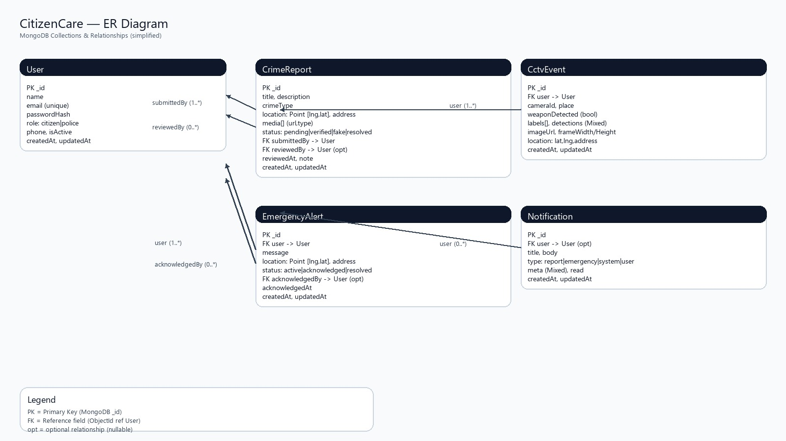

# CitizenCare — Project Report

**Project Title:** CitizenCare – Smart Public Safety & Crime Alert System  
**Project Type:** Full‑Stack Web Application with AI‑assisted CCTV detection  
**Academic Type:** Student Project Report  
**Date:** 2026-04-27

---

## Abstract
CitizenCare is a full‑stack public safety web application that helps citizens report incidents and helps police/admin monitor verified reports, emergency SOS alerts, and AI‑assisted CCTV detections in real time. The system includes a React (Vite) frontend, a Node.js + Express REST API, MongoDB for data storage, Socket.io for real‑time notifications, and an optional Python (Flask) YOLOv8 service for weapon/suspicious object detection from CCTV frames. The solution aims to improve response time, increase situational awareness, and provide data‑driven safety status for a selected area.

---

## 1. Introduction
Public safety systems often suffer from slow reporting, lack of real‑time coordination, and limited visibility of incident hotspots. Many citizens also fail to report incidents due to complicated processes. CitizenCare addresses these problems by providing a simple reporting interface, a verification workflow for authorities, real‑time SOS alerts, and an AI module that can detect potential weapons from CCTV camera frames to generate immediate staff alerts.

---

## 2. Problem Statement
- Incident reporting is often **slow and unstructured**, causing delays in response.
- Authorities may not receive **real‑time alerts** when emergencies happen.
- CCTV monitoring is mostly manual; suspicious activity can be missed.
- Citizens need a **simple safety indicator** for an area based on recent activity.

---

## 3. Objectives
- Provide a secure platform for **citizen registration/login** and reporting.
- Enable police/admin to **verify, manage, and analyze** incidents.
- Deliver **real‑time notifications** (SOS, report updates, CCTV alerts) using Socket.io.
- Integrate an optional **AI CCTV service** for weapon/suspicious detection (YOLOv8).
- Show incidents and safety status on a **map interface** (Google Maps API optional).

---

## 4. Scope of the Project
### 4.1 In Scope
- User authentication (JWT) and role‑based access (citizen, police/admin).
- Crime report submission with location and optional media upload.
- Verification workflow (pending → verified/fake/resolved).
- SOS emergency alerting and staff notification.
- Dashboard analytics (type summary, trends).
- Optional CCTV AI pipeline (browser camera → API → Python YOLOv8 → alert).

### 4.2 Out of Scope
- Nationwide production deployment, government integrations, 999/911 integrations.
- Guaranteed gun detection without a custom trained model (COCO limitation).
- Advanced ML forecasting (only a rule‑based safety scoring in this version).

---

## 5. Methodology
CitizenCare was developed using an incremental approach:
- Requirements collection (citizen portal + police portal + CCTV AI).
- Modular implementation (auth, reports, alerts, CCTV, analytics).
- Integration of real‑time Socket.io events.
- Optional AI service integration using REST between Node and Python.
- Manual testing using defined test cases.

---

## 6. Tools and Technologies
### 6.1 Frontend
- React 18, Vite 5
- Tailwind CSS 3
- React Router
- Socket.io client
- Recharts (analytics charts)
- Google Maps (`@react-google-maps/api`) – optional

### 6.2 Backend
- Node.js (>=18), Express
- MongoDB, Mongoose ODM
- Socket.io server
- JWT Auth (`jsonwebtoken`)
- Password hashing (`bcryptjs`)
- Validation (`express-validator`)
- Security headers (`helmet`), CORS (`cors`)
- File upload (`multer`) and optional Cloudinary

### 6.3 AI Module (Optional)
- Python 3.10+
- Flask + Flask-CORS
- Ultralytics YOLOv8
- Pillow, NumPy

### 6.4 Development Tools
- Cursor / VS Code (coding IDE)
- Git + GitHub (version control)
- Postman/Insomnia (API testing)
- MongoDB Compass (DB GUI)
- Chrome/Edge DevTools (debugging)
- PowerShell / Windows Terminal

---

## 7. System Architecture
CitizenCare follows a 3‑service architecture in development:

1. **Client (React SPA)** runs on port 5173 (Vite).
2. **Server (Node/Express API + Socket.io)** runs on port 5000.
3. **AI Service (Python Flask YOLOv8)** runs on port 5050 (optional).

### 7.1 Data Flow (CCTV AI)
- Browser camera captures frames (~1 FPS) from `/cctv` page.
- Frames are sent to Node endpoint `POST /api/cctv/upload-frame`.
- Node forwards the image to Python `POST /detect`.
- Python returns detections; Node stores `CctvEvent` and emits `cctv-alert` to staff.

---

## 8. Key Modules and Features
### 8.1 Authentication & Authorization
- JWT based login/register.
- Roles supported: **citizen** and **police/admin**.
- Protected API endpoints require `Authorization: Bearer <token>`.

### 8.2 Crime Reports
- Citizens submit reports with title, description, crime type, and geo‑location.
- Media uploads supported (local storage or Cloudinary).
- Police/admin can list reports, filter by status/type, and verify them.

### 8.3 Emergency SOS
- Citizens can send an SOS with location.
- Staff receive a real‑time notification through Socket.io.

### 8.4 Map & Safety Status
- Verified incidents can be displayed on Google Maps.
- A **safety score** is computed using recent verified crimes and CCTV events:
  - riskScore = (crimes × 2) + (weapons × 3)
  - Status: SAFE / LOW RISK / HIGH RISK

### 8.5 Analytics Dashboard
- Summary counts and time‑based trends.
- Visualized using charts (Recharts).

### 8.6 CCTV AI Weapon Detection (Optional)
- YOLOv8 inference on frames.
- Sends staff alert if a weapon class is detected (e.g., knife from COCO).
- For gun detection, custom trained weights are required.

---

## 9. Database Design (MongoDB)
MongoDB collections (high level):
- **Users**: name, email, passwordHash, role, isActive, createdAt
- **CrimeReport**: submitter, title, description, crimeType, location (lat/lng), status, mediaUrls, timestamps
- **Alert (SOS)**: user, message, location, timestamps, acknowledgedBy
- **Notification**: user, type, title, body, read flag, timestamps
- **CctvEvent**: user, labels, weaponDetected, detections, imageUrl/snapshot, location, timestamps

ER diagrams are provided in:
- `docs/er-diagram.jpg`
- `docs/er-diagram-chen-1x1.jpg`

### 9.1 ER Diagram (Implementation)
**Figure 1:** ER diagram (database entities and relationships)

---

## 10. Security Considerations
- Passwords are hashed using bcrypt.
- JWT tokens are used for authentication.
- Role checks protect staff/admin endpoints.
- Helmet and CORS improve baseline API security.
- Environment variables are used for secrets (`JWT_SECRET`, DB URI, API keys).

---

## 11. Testing and Results
Manual testing was performed using defined test cases.
- Test case sheet PDF: `docs/test-cases.pdf`
- Example tested areas: health checks, registration, login, report flow, CCTV pipeline, safety status, real‑time refresh.

**Result Summary:** All listed test cases were executed with **PASS** status in the prepared test sheet.

---

## 12. Limitations
- COCO YOLO model does not reliably include firearms; a custom dataset/model is needed.
- Real‑time CCTV streaming is simplified to frame uploads (~1 FPS) for performance.
- Safety scoring is rule‑based and depends on data availability and quality.
- Production deployment needs HTTPS, hardened CORS, and proper storage for uploads.

---

## 13. Future Improvements
- Train and deploy a custom weapon detection model (gun/knife classes).
- Add rate limiting, audit logs, and admin activity monitoring.
- Add GeoJSON + 2dsphere indexing for faster radius queries.
- Add caching for `safety-status` endpoint and better visualization (heatmap).
- Add push notifications (mobile) and advanced incident classification.

---

## 14. Conclusion
CitizenCare demonstrates how a modern web application can combine reporting, real‑time communication, and AI‑assisted CCTV detection to improve public safety monitoring. The system provides a structured workflow for incident handling, live alerts for staff, and a safety indicator for citizens. The modular architecture also allows future upgrades such as custom ML models and production-grade deployment.

---

## 15. Implementation Screenshots
This section includes screenshots from the implemented system (UI and key modules).

**Figure 2:** Application UI (Screenshot 1)

**Figure 3:** Application UI (Screenshot 2)

**Figure 4:** Application UI (Screenshot 3)

**Figure 5:** Application UI (Screenshot 4)

**Figure 6:** Application UI (Screenshot 5)

## References
- React Documentation
- Express.js Documentation
- MongoDB + Mongoose Documentation
- Socket.io Documentation
- Ultralytics YOLOv8 Documentation

